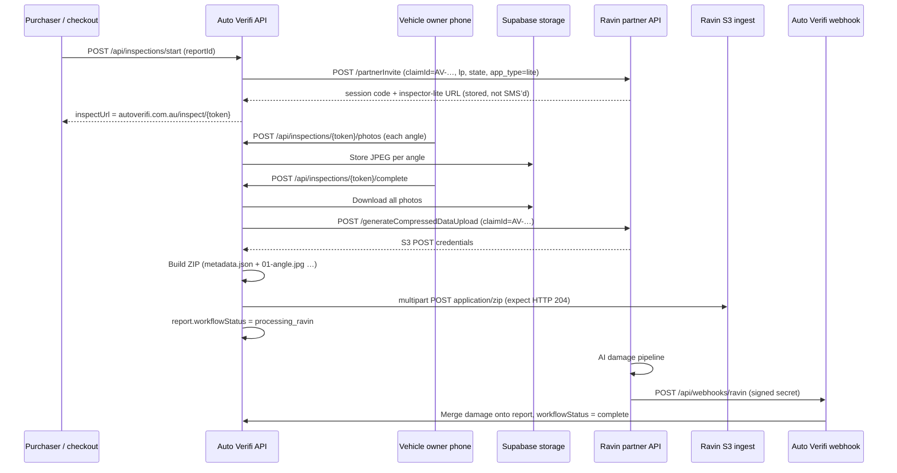

# Ravin AI integration (Auto Verifi Insights+)

Auto Verifi uses a **custom mobile capture UI**. Ravin provides **partner registration**, **S3 ingest**, and **webhooks** for AI damage analysis. Owners are **not** sent through Ravin’s hosted `inspector-lite` URL in production.

## Architecture (sequence)



## Identifiers Ravin should use

| Field | Auto Verifi value | Notes |
|--------|-------------------|--------|
| **claimId** | `AV-…` report id | Same string sent to `partnerInvite` and S3 metadata |
| **ravinInspectionId** (DB) | Usually same as `claimId` | Not Ravin’s UUID `code` query param |
| **Session `code`** | From invite URL | e.g. `?code=69be1468-…` — for Ravin Eye correlation only |
| **S3 object** | ZIP from `generateCompressedDataUpload` policy `key` | Contains `metadata.json` + numbered JPEGs; success = **HTTP 204** |

## Production health (no secrets)

```bash
curl -s "https://www.autoverifi.com.au/api/health/ravin?probe=1"
```

Expect `partnerApiConfigured`, `s3IngestConfigured`, and `webhookSecretConfigured` all `true` for live Insights+.

## Ops trace (per report)

Requires `AUTOVERIFI_OPS_SECRET` on Vercel and header `x-autoverifi-ops-key`.

Response includes **`s3Ingest`** (full `[ravin-ingest]` trace saved automatically on each inspection submit) and **`s3IngestError`** if the last upload failed — no manual Vercel log search needed for Ravin support.

```bash
curl -s -H "x-autoverifi-ops-key: YOUR_OPS_SECRET" \
  "https://www.autoverifi.com.au/api/health/ravin?reportId=AV-MV9BM5AL-8DH8BW61"
```

Response includes photo count, Ravin session code, expected S3 key pattern, webhook history, and `nextSteps`.

## Reference traces (2026-10-17)

### Ford Ranger — Denise (`AV-MV9BM5AL-8DH8BW61`)

| Check | Result |
|--------|--------|
| Report | Found, Insights+ |
| Workflow | `processing_ravin` |
| Photos on Auto Verifi | **18** (inspection `uploaded`) |
| claimId / ravinInspectionId | `AV-MV9BM5AL-8DH8BW61` |
| Ravin session code | `69be1468-40f1-708a-650e-54e7cbc2dbc5` |
| Webhooks received | **None** |
| Likely issue | S3 objects not matched in Ravin Eye and/or webhook never fired for this claim |

**Ask Ravin:** Confirm ingest for claimId `AV-MV9BM5AL-8DH8BW61` and session `69be1468-40f1-708a-650e-54e7cbc2dbc5`; re-send webhook or manual reprocess if ingest succeeded.

### OOO274 preview test (`AV-MVBBQEZW-1RTE454R`)

| Check | Result |
|--------|--------|
| Report | Found, Insights+ |
| Workflow | `complete` |
| Photos | **2** only (partial capture) |
| claimId | `AV-MVBBQEZW-1RTE454R` |
| Ravin session code | `b97ec488-1051-70aa-7155-c276deaa42fc` |
| Webhooks received | **None** |
| Note | Report marked complete with minimal photos — not a full walkaround; damage analysis may be empty or from non-Ravin path |

**Ask Ravin:** Same S3/webhook checks for `AV-MVBBQEZW-1RTE454R`; clarify whether lite link click is required on their side when `imageUpload: true` but upload is **server-side S3**.

## Message for Denise (internal — new inspection test)

Hi Denise,

Please run **one fresh Insights+ inspection** on **www.autoverifi.com.au** so we can give Ravin a clean ZIP upload with a real **claimId**.

**Steps**

1. Checkout **Insights+** (test rego/VIN is fine) and start the vehicle inspection (SMS to owner, or your phone if you are testing as owner).
2. Open our link only — **Auto Verifi `/inspect/…`** (not Ravin’s app).
3. Take walkaround photos (as many angles as you can; full set is best).
4. Tap **Submit** and note the date/time (Sydney).

**Send Ali only**

- **Report ID** from the URL or email (starts with **AV-…**)
- **Approximate submit time**

You do **not** need to worry about Ravin “link not clicked” — that is normal. You do **not** need to collect logs — our system saves the Ravin upload trace automatically when you submit.

Thanks!

---

## Email to Ravin (copy for Denise → Danny)

**Subject:** Re: S3 ZIP upload — claimId, inspect host, ingest trace

Hi Danny,

Thanks for confirming **inspect.mtaus** is the correct environment (not beta). We use **`https://inspect.mtaus.ravin-ai.com`** for **`partnerInvite`**, **`getSignInToken`**, and **`generateCompressedDataUpload`**.

**claimId (not empty in our API calls)**  
Sorry our earlier email summary showed an empty `claimId` — that was a placeholder in the written example, not the JSON we POST. In production we always send the **Auto Verifi report id** as **`claimId`**, matching **`partnerInvite`**, for example:

```json
{
  "clientId": "autoverifi",
  "siteId": 49,
  "claimId": "AV-MV9BM5AL-8DH8BW61",
  "timestamp": 20261019042129
}
```

The same **`claimId`** is included in **`metadata.json`** inside the ZIP. Empty **`claimId`** correctly returns **`{"error":"claimId is required"}`** on your API — we fail fast on our side if the report id is missing.

**Flow on inspection submit (server-side)**

1. `POST https://inspect.mtaus.ravin-ai.com/generateCompressedDataUpload` (payload above).
2. Build one **ZIP**: **`metadata.json`** + numbered JPEGs (`01-front_left.jpg`, …).
3. Multipart POST to S3 (SigV4 fields from your response). Success = **HTTP 204**.
4. We store a full **ingest trace** on the inspection record (claimId, HTTP statuses, S3 status, zip key/size). After our next test we will send you that **JSON trace** directly.

**Please check on inspect**

| claimId | Ravin session code | Photos (Auto Verifi) | Webhooks to Auto Verifi |
|--------|---------------------|----------------------|-------------------------|
| **AV-MV9BM5AL-8DH8BW61** | `69be1468-40f1-708a-650e-54e7cbc2dbc5` | 18 | **0** |
| **AV-MVBBQEZW-1RTE454R** | `b97ec488-1051-70aa-7155-c276deaa42fc` | 2 (partial) | **0** |

**Webhook:** `POST https://www.autoverifi.com.au/api/webhooks/ravin` (header **`x-ravin-webhook-secret`**).

**Asks**

1. On **inspect**, for **`autoverifi` / site 49**, do you see **`generateCompressedDataUpload`** and ZIP ingest for the next test **claimId** we send you?
2. Please share the required **`metadata.json`** schema (or sample) if ours should differ.
3. For **AV-MV9BM5AL-8DH8BW61**, can you reprocess or resend the webhook if ingest is found?
4. Happy to join a **Tuesday** dev call — please send a calendar invite.

We will reply with the **ingest trace JSON** as soon as we complete a fresh test inspection.

Thanks,  
Denise  
Auto Verifi

## Auto Verifi automation (no Ravin pull API)

| Mechanism | What it does |
|-----------|----------------|
| **POST `/api/webhooks/ravin`** | Applies damage when Ravin pushes `sendEventReport`. |
| **GET `/api/report/[id]/insights-sync`** | Replays **stored** webhooks when the customer opens the report. |
| **Vercel Cron** `GET /api/cron/ravin-sync` every **10 min** | Replays stored webhooks for all `processing_ravin` reports; sends **one** ops email per inspection if still no damage after **`RAVIN_STUCK_ALERT_HOURS`** (default 2). |
| **Inspection complete** | After S3 upload, tries webhook replay once in the background. |

Cron auth: set **`CRON_SECRET`** on Vercel (Vercel sends `Authorization: Bearer …` on cron invocations). Manual run: same bearer or `x-autoverifi-ops-key`.

Damage data still **cannot** be invented without Ravin — automation only applies webhooks Ravin has already sent (or alerts ops when none arrive).

## Environment (Vercel)

| Variable | Purpose |
|----------|---------|
| `RAVIN_API_KEY` | `getSignInToken`, `partnerInvite` |
| `RAVIN_SITE_ID` | Site 49 (consumer) |
| `RAVIN_WEBHOOK_SECRET` | Validates Ravin POST body |
| `RAVIN_S3_*` or dynamic creds | S3 POST via `generateCompressedDataUpload` |
| `AUTOVERIFI_OPS_SECRET` | Ops trace header |
| `CRON_SECRET` | Secures `/api/cron/ravin-sync` |
| `RAVIN_STUCK_ALERT_HOURS` | Delay before Ravin stuck ops email (default 2) |

## Code map

| Step | Location |
|------|----------|
| Create invite | `src/app/api/inspections/start/route.ts` → `createRavinPartnerInvite` |
| Owner photos | `src/app/api/inspections/[token]/photos/route.ts` |
| S3 ingest | `src/app/api/inspections/[token]/complete/route.ts` → `submitInspectionToRavin` |
| ZIP package | `src/lib/ravin-compressed-zip.ts` |
| Ingest logs | `src/lib/ravin-ingest-log.ts` (`[ravin-ingest]` JSON) |
| Partner + S3 API | `src/lib/ravin-partner.ts`, `src/lib/ravin-ingest.ts` |
| Webhook | `src/app/api/webhooks/ravin/route.ts` |
| Ops trace | `src/lib/ravin-report-trace.ts`, `GET /api/health/ravin?reportId=` |
