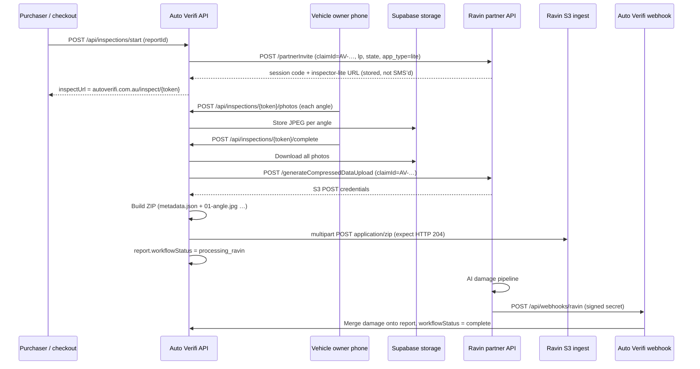

# Ravin AI integration (Auto Verifi Insights+)

Auto Verifi uses a **custom mobile capture UI**. Ravin provides **partner registration**, **S3 ingest**, and **webhooks** for AI damage analysis. Owners are **not** sent through Ravin’s hosted `inspector-lite` URL in production.

## Architecture (sequence)



## Identifiers Ravin should use

| Field | Auto Verifi value | Notes |
|--------|-------------------|--------|
| **claimId** | `AV-…` report id | Same string sent to `partnerInvite` and S3 metadata |
| **ravinInspectionId** (DB) | Usually same as `claimId` | Not Ravin’s UUID `code` query param |
| **Session `code`** | From invite URL | e.g. `?code=69be1468-…` — for Ravin Eye correlation only |
| **S3 object** | ZIP from `generateCompressedDataUpload` policy `key` | Contains `metadata.json` + numbered JPEGs; success = **HTTP 204** |

## Production health (no secrets)

```bash
curl -s "https://www.autoverifi.com.au/api/health/ravin?probe=1"
```

Expect `partnerApiConfigured`, `s3IngestConfigured`, and `webhookSecretConfigured` all `true` for live Insights+.

## Ops trace (per report)

Requires `AUTOVERIFI_OPS_SECRET` on Vercel and header `x-autoverifi-ops-key`.

Response includes **`s3Ingest`** (full `[ravin-ingest]` trace saved automatically on each inspection submit) and **`s3IngestError`** if the last upload failed — no manual Vercel log search needed for Ravin support.

```bash
curl -s -H "x-autoverifi-ops-key: YOUR_OPS_SECRET" \
  "https://www.autoverifi.com.au/api/health/ravin?reportId=AV-MV9BM5AL-8DH8BW61"
```

Response includes photo count, Ravin session code, expected S3 key pattern, webhook history, and `nextSteps`.

## Reference traces (2026-10-17)

### Ford Ranger — Denise (`AV-MV9BM5AL-8DH8BW61`)

| Check | Result |
|--------|--------|
| Report | Found, Insights+ |
| Workflow | `processing_ravin` |
| Photos on Auto Verifi | **18** (inspection `uploaded`) |
| claimId / ravinInspectionId | `AV-MV9BM5AL-8DH8BW61` |
| Ravin session code | `69be1468-40f1-708a-650e-54e7cbc2dbc5` |
| Webhooks received | **None** |
| Likely issue | S3 objects not matched in Ravin Eye and/or webhook never fired for this claim |

**Ask Ravin:** Confirm ingest for claimId `AV-MV9BM5AL-8DH8BW61` and session `69be1468-40f1-708a-650e-54e7cbc2dbc5`; re-send webhook or manual reprocess if ingest succeeded.

### OOO274 preview test (`AV-MVBBQEZW-1RTE454R`)

| Check | Result |
|--------|--------|
| Report | Found, Insights+ |
| Workflow | `complete` |
| Photos | **2** only (partial capture) |
| claimId | `AV-MVBBQEZW-1RTE454R` |
| Ravin session code | `b97ec488-1051-70aa-7155-c276deaa42fc` |
| Webhooks received | **None** |
| Note | Report marked complete with minimal photos — not a full walkaround; damage analysis may be empty or from non-Ravin path |

**Ask Ravin:** Same S3/webhook checks for `AV-MVBBQEZW-1RTE454R`; clarify whether lite link click is required on their side when `imageUpload: true` but upload is **server-side S3**.

## Email to Ravin (copy for Denise → Danny)

**Subject:** Auto Verifi — S3 compressed upload + prod vs beta API host

Hi Danny,

Thanks for clarifying that the **inspector-lite session code** and the **S3 upload API** are separate — that matches our design. Vehicle owners capture on **Auto Verifi** (`https://www.autoverifi.com.au/inspect/{token}`). We call **partnerInvite** at inspection start with **claimId = our report id**; we do **not** require the owner to open the lite link (if Ravin Eye shows “link not clicked”, that is expected).

**Important — API host (prod vs beta)**  
Your note referenced  
`https://beta.mtaus.ravin-ai.com/generateCompressedDataUpload`.  
Our **production Vercel** env uses **`RAVIN_BASE_URL=https://inspect.mtaus.ravin-ai.com`**, so all **`generateCompressedDataUpload`**, **`getSignInToken`**, and **`partnerInvite`** calls go to **inspect**, not beta. If your team only monitors **beta** logs, you would not see our traffic. Can you please check **inspect** for **clientId `autoverifi`**, **siteId `49`**, and confirm which host Auto Verifi should use going forward?

**What we do on inspection submit (server-side)**  
In production today:

1. `POST https://inspect.mtaus.ravin-ai.com/generateCompressedDataUpload`  
   JSON: `clientId: "autoverifi"`, `siteId: 49`, `claimId: "AV-MV9BM5AL-8DH8BW61"` (report id), `timestamp: <UTC YYYYMMDDHHmmss number>` — same `claimId` inside `metadata.json` in the ZIP
2. Build one **ZIP**: `metadata.json` + numbered JPEGs (`01-front_left.jpg`, …).
3. Single multipart POST to S3 using fields from your JSON (SigV4 where returned). Success = **HTTP 204** (we also accept 200/201).
4. Structured logs in Vercel: lines prefixed **`[ravin-ingest]`** (JSON: claimId, auth HTTP status, S3 status, object key, zip size, errors).

**Production health (public probe, no secrets)**  
`GET https://www.autoverifi.com.au/api/health/ravin?probe=1` → `partnerApiConfigured`, `s3IngestConfigured`, `webhookSecretConfigured` all **true**; `baseUrl` **https://inspect.mtaus.ravin-ai.com**; `siteId` **49**; `partnerSignIn.ok` **true**.

**Claims to look up**

| claimId | Ravin session code (partnerInvite) | Photos (Auto Verifi) | Webhooks to us |
|--------|-------------------------------------|----------------------|----------------|
| **AV-MV9BM5AL-8DH8BW61** | `69be1468-40f1-708a-650e-54e7cbc2dbc5` | 18 | **0** |
| **AV-MVBBQEZW-1RTE454R** | `b97ec488-1051-70aa-7155-c276deaa42fc` | 2 (partial test) | **0** |

Earlier submits may have used per-file JPEG upload; **new** completes use ZIP + metadata as above.

**Webhook**  
`POST https://www.autoverifi.com.au/api/webhooks/ravin` — header **`x-ravin-webhook-secret`** (shared secret configured on both sides).

**Asks**

1. On **inspect** (not only beta), do you see **`generateCompressedDataUpload`** for **`AV-MV9BM5AL-8DH8BW61`** / **`autoverifi`** / site **49**?  
2. Can you share the required **`metadata.json`** schema (or a sample) so we match Ravin Eye exactly?  
3. For a sandbox test, should we call **inspect** or **beta** with your params (`clientId: test`, `claimId: s3uploadtest`, `siteId: 49`)?  
4. If ingest exists for **AV-MV9BM5AL-8DH8BW61**, can you reprocess or resend the webhook?

We will forward **`[ravin-ingest]`** log lines from Vercel after the next test submit on request.

Thanks,  
Denise  
Auto Verifi

## Environment (Vercel)

| Variable | Purpose |
|----------|---------|
| `RAVIN_API_KEY` | `getSignInToken`, `partnerInvite` |
| `RAVIN_SITE_ID` | Site 49 (consumer) |
| `RAVIN_WEBHOOK_SECRET` | Validates Ravin POST body |
| `RAVIN_S3_*` or dynamic creds | S3 POST via `generateCompressedDataUpload` |
| `AUTOVERIFI_OPS_SECRET` | Ops trace header |

## Code map

| Step | Location |
|------|----------|
| Create invite | `src/app/api/inspections/start/route.ts` → `createRavinPartnerInvite` |
| Owner photos | `src/app/api/inspections/[token]/photos/route.ts` |
| S3 ingest | `src/app/api/inspections/[token]/complete/route.ts` → `submitInspectionToRavin` |
| ZIP package | `src/lib/ravin-compressed-zip.ts` |
| Ingest logs | `src/lib/ravin-ingest-log.ts` (`[ravin-ingest]` JSON) |
| Partner + S3 API | `src/lib/ravin-partner.ts`, `src/lib/ravin-ingest.ts` |
| Webhook | `src/app/api/webhooks/ravin/route.ts` |
| Ops trace | `src/lib/ravin-report-trace.ts`, `GET /api/health/ravin?reportId=` |
