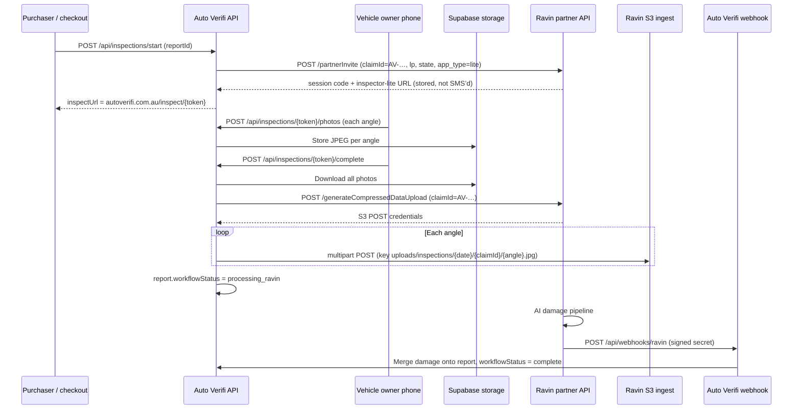

# Ravin AI integration (Auto Verifi Insights+)

Auto Verifi uses a **custom mobile capture UI**. Ravin provides **partner registration**, **S3 ingest**, and **webhooks** for AI damage analysis. Owners are **not** sent through Ravin’s hosted `inspector-lite` URL in production.

## Architecture (sequence)



## Identifiers Ravin should use

| Field | Auto Verifi value | Notes |
|--------|-------------------|--------|
| **claimId** | `AV-…` report id | Same string sent to `partnerInvite` and S3 metadata |
| **ravinInspectionId** (DB) | Usually same as `claimId` | Not Ravin’s UUID `code` query param |
| **Session `code`** | From invite URL | e.g. `?code=69be1468-…` — for Ravin Eye correlation only |
| **S3 prefix** | `uploads/inspections/{YYYY-MM-DD}/{claimId}/` | One object per inspection angle |

## Production health (no secrets)

```bash
curl -s "https://www.autoverifi.com.au/api/health/ravin?probe=1"
```

Expect `partnerApiConfigured`, `s3IngestConfigured`, and `webhookSecretConfigured` all `true` for live Insights+.

## Ops trace (per report)

Requires `AUTOVERIFI_OPS_SECRET` on Vercel and header `x-autoverifi-ops-key`.

```bash
curl -s -H "x-autoverifi-ops-key: YOUR_OPS_SECRET" \
  "https://www.autoverifi.com.au/api/health/ravin?reportId=AV-MV9BM5AL-8DH8BW61"
```

Response includes photo count, Ravin session code, expected S3 key pattern, webhook history, and `nextSteps`.

## Reference traces (2026-10-17)

### Ford Ranger — Denise (`AV-MV9BM5AL-8DH8BW61`)

| Check | Result |
|--------|--------|
| Report | Found, Insights+ |
| Workflow | `processing_ravin` |
| Photos on Auto Verifi | **18** (inspection `uploaded`) |
| claimId / ravinInspectionId | `AV-MV9BM5AL-8DH8BW61` |
| Ravin session code | `69be1468-40f1-708a-650e-54e7cbc2dbc5` |
| Webhooks received | **None** |
| Likely issue | S3 objects not matched in Ravin Eye and/or webhook never fired for this claim |

**Ask Ravin:** Confirm ingest for claimId `AV-MV9BM5AL-8DH8BW61` and session `69be1468-40f1-708a-650e-54e7cbc2dbc5`; re-send webhook or manual reprocess if ingest succeeded.

### OOO274 preview test (`AV-MVBBQEZW-1RTE454R`)

| Check | Result |
|--------|--------|
| Report | Found, Insights+ |
| Workflow | `complete` |
| Photos | **2** only (partial capture) |
| claimId | `AV-MVBBQEZW-1RTE454R` |
| Ravin session code | `b97ec488-1051-70aa-7155-c276deaa42fc` |
| Webhooks received | **None** |
| Note | Report marked complete with minimal photos — not a full walkaround; damage analysis may be empty or from non-Ravin path |

**Ask Ravin:** Same S3/webhook checks for `AV-MVBBQEZW-1RTE454R`; clarify whether lite link click is required on their side when `imageUpload: true` but upload is **server-side S3**.

## Email to Ravin (template)

> We use **custom front-end capture** at `autoverifi.com.au/inspect/…`. We call **partnerInvite** with **claimId = our report id** (`AV-…`). We **do not** require the owner to open the inspector-lite link — your logs may show “link not clicked”; that is expected.
>
> On complete, our server uploads JPEGs to your S3 ingest using **generateCompressedDataUpload** with the same **claimId**, keys under `uploads/inspections/{date}/{claimId}/{angle}.jpg`, metadata **x-amz-meta-inspection-id**.
>
> Please confirm ingest + processing for:
> - **AV-MV9BM5AL-8DH8BW61** (session code `69be1468-40f1-708a-650e-54e7cbc2dbc5`, 18 images)
> - **AV-MVBBQEZW-1RTE454R** (session code `b97ec488-1051-70aa-7155-c276deaa42fc`, 2 images)
>
> Webhook endpoint: `https://www.autoverifi.com.au/api/webhooks/ravin` (shared secret configured). We have **zero** webhook rows for both claims.

## Environment (Vercel)

| Variable | Purpose |
|----------|---------|
| `RAVIN_API_KEY` | `getSignInToken`, `partnerInvite` |
| `RAVIN_SITE_ID` | Site 49 (consumer) |
| `RAVIN_WEBHOOK_SECRET` | Validates Ravin POST body |
| `RAVIN_S3_*` or dynamic creds | S3 POST via `generateCompressedDataUpload` |
| `AUTOVERIFI_OPS_SECRET` | Ops trace header |

## Code map

| Step | Location |
|------|----------|
| Create invite | `src/app/api/inspections/start/route.ts` → `createRavinPartnerInvite` |
| Owner photos | `src/app/api/inspections/[token]/photos/route.ts` |
| S3 ingest | `src/app/api/inspections/[token]/complete/route.ts` → `submitInspectionToRavin` |
| Partner + S3 API | `src/lib/ravin-partner.ts`, `src/lib/ravin-ingest.ts` |
| Webhook | `src/app/api/webhooks/ravin/route.ts` |
| Ops trace | `src/lib/ravin-report-trace.ts`, `GET /api/health/ravin?reportId=` |
